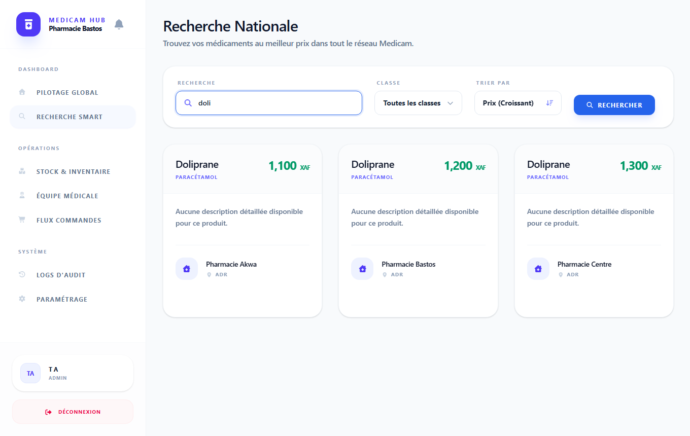
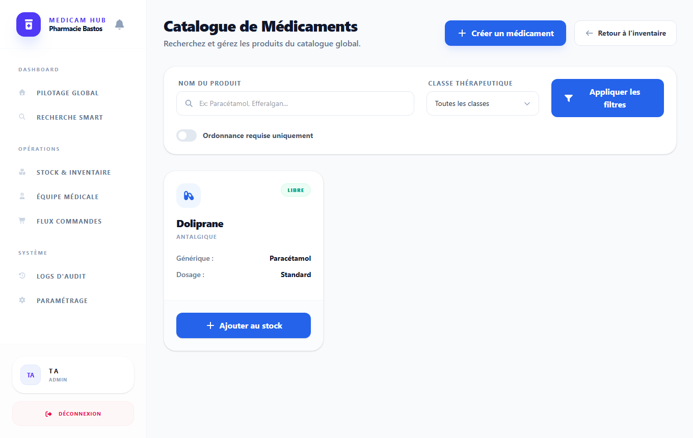

# EasyPharma en ASP.NET Core : une tranche du backend portée sur C# / SQL Server

Réécriture, en **C# / ASP.NET Core 10**, d'une tranche de l'API EasyPharma (recherche et commande de médicaments au Cameroun), initialement écrite en Java / Spring Boot.
L'API .NET **partage la même base SQL Server** que la version Java et reste compatible avec elle : mêmes tables, mêmes mots de passe (BCrypt), mêmes jetons JWT, mêmes formes JSON. Le **front Angular d'origine fonctionne dessus sans modification du code applicatif** : la pile C# / Angular / SQL Server tourne avec une seule commande `docker compose`.



| | |
|---|---|
| Stack | C# 14 / .NET 10, ASP.NET Core (contrôleurs), EF Core 10 (SQL Server), JWT Bearer, Swashbuckle (Swagger), BCrypt.Net, xUnit, Testcontainers ; front Angular 21 (dossier `web/`), nginx, Playwright |
| Base | SQL Server 2022, schéma du dépôt [`easypharma-backend-lab`](https://github.com/samsteeven/easypharma-backend-lab) (scripts recopiés dans `db/`) |
| Origine | Projet d'équipe M1 EADL (Spring Boot + Angular) ; ce dépôt réimplémente uniquement le périmètre ci-dessous |

## Périmètre porté

| Endpoint | Accès | Rôle |
|---|---|---|
| `POST /api/v1/auth/register` | public | inscription d'un patient (409 si email ou téléphone déjà pris) |
| `POST /api/v1/auth/login` | public | connexion, jeton JWT |
| `GET /api/v1/auth/me`, `GET /api/v1/users/me` | JWT | utilisateur courant (avec le nom de sa pharmacie) |
| `POST /api/v1/auth/logout`, `POST /api/v1/auth/refresh-token` | public | déconnexion sans état ; le rafraîchissement renvoie 401 (non pris en charge) |
| `GET /api/v1/medications`, `/search`, `/filter`, `/{id}` | JWT | catalogue global, recherche insensible à la casse, filtres combinables |
| `GET /api/v1/patient/search` | JWT | recherche globale (nom, générique, symptôme, classe) ; tris `PRICE`, `RATING`, `NEAREST` (Haversine) et `POSTGIS_NEAREST` (`STDistance` en SQL, nom conservé pour le front) |
| `GET /api/v1/pharmacies/{id}` | public | fiche d'une pharmacie |
| `GET /api/v1/pharmacies/nearby` | public | pharmacies approuvées dans un rayon, de la plus proche à la plus lointaine (`STDistance`) |
| `POST /api/v1/orders`, `GET /orders/my-orders` (alias `/orders/me`, URL du front), `GET /orders/{id}` | JWT (patient) | commande : stock vérifié, prix figés, frais de livraison par distance |

Non portés (hors périmètre) : paiement, livraison, ordonnances, notifications, avis, back-office, rafraîchissement de jeton (`refresh_token` est renvoyé à `null`).

## Compatibilité avec la version Spring Boot

- **Mots de passe** : un utilisateur créé par Spring Boot se connecte sur l'API .NET (le hash `$2a$` de Spring Security est vérifié par BCrypt.Net) ; testé avec un hash réel produit par Spring.
- **Jetons JWT** : même secret base64 (`Jwt:Secret` = `app.jwt.secret`), HS256, mêmes claims (`sub` = email, `userId`, `email`, `role`, `firstName`, `lastName`). Les deux API peuvent donc accepter le jeton de l'autre.
- **JSON** : mêmes noms de champs, énumérations en texte, enveloppe `{success, message, data, timestamp}` pour l'authentification, tableaux nus pour le catalogue et les pharmacies, réponse d'authentification en `access_token` / `token_type` / `expires_in`.
- **Règles métier** reproduites : frais de livraison `500 + 100 × km` (arrondi à 2 décimales), distance de Haversine (rayon 6371 km), numéro de commande `ORD-<millisecondes>`, statut initial `PENDING`, prix unitaire figé à la commande.
- **Schéma** : accès « database first » (aucune migration EF Core) ; les scripts `db/V1`, `db/V2` sont ceux du backend Java.

## Front Angular (`web/`)

Le front de l'application d'origine (Angular 21, Tailwind, back-office des pharmacies et de l'administration) est copié dans `web/`. Il appelle l'API par des chemins relatifs `/api/v1/...` : seul le proxy change (`web/default.conf` pour nginx, `web/proxy.conf.json` pour `ng serve`). Les écrans suivants fonctionnent de bout en bout sur l'API .NET :

- connexion et inscription (réponse `access_token` / `user`, redirection selon le rôle) ;
- catalogue des médicaments (liste, recherche, filtres) ;
- recherche nationale (`/patient/search`), triée par prix, note ou distance ;
- fiche de la pharmacie connectée, profil utilisateur.



Les autres écrans (inventaire, commandes de la pharmacie, livraisons, paiements, employés, tableaux de bord, ordonnances) appellent des endpoints **non portés** et affichent donc des erreurs 404 : le tableau de bord de la pharmacie, par exemple, interroge `/pharmacies/{id}/medications` et `/orders/pharmacy-orders/{id}`.

Comptes de démonstration (mot de passe `Test1234!`, créés par `db/seed.sql`) : `a1@test.local` à `a4@test.local` (propriétaires de pharmacie, `a2` = Bastos) et `admin@easypharma.local` (super administrateur).
Un utilisateur `PATIENT` n'a pas d'écran dans ce front (les patients utilisaient l'application mobile) : après connexion il est renvoyé vers la page de connexion.

Parcours automatisé dans un vrai navigateur (Playwright), qui se connecte, ouvre le catalogue puis la recherche nationale et affiche les appels API observés :
```bash
docker compose up -d --build                        # front sur http://localhost:4200
cd e2e && npm install && npx playwright install chromium
BASE=http://localhost:4200 npm test                 # captures dans docs/
```

## Démarrage

Prérequis : Docker (le SDK .NET 10 pour développer l'API, Node 22+ pour développer le front).

```bash
cp .env.example .env     # renseigner MSSQL_SA_PASSWORD (mot de passe fort) et JWT_SECRET (>= 32 octets, base64)
docker compose up -d --build
```
Le compose démarre SQL Server 2022, applique le schéma et 4 pharmacies de démonstration (`db/init.sh`, une seule fois), puis lance l'API sous un utilisateur non root.
Front : <http://localhost:4200> · Swagger : <http://localhost:8080/swagger> (modifier `WEB_PORT` / `API_PORT` / `MSSQL_PORT` dans `.env` en cas de conflit de ports).

```bash
curl "http://localhost:8080/api/v1/pharmacies/nearby?latitude=3.855&longitude=11.51&radiusKm=10"     # Bastos, Centre
curl -X POST http://localhost:8080/api/v1/auth/register -H 'Content-Type: application/json' \
  -d '{"email":"moi@test.local","password":"Test1234!","firstName":"Moi","lastName":"Test","phone":"690000001"}'
```

Sans Docker pour l'API : `dotnet run --project src/EasyPharma.Api` avec `ConnectionStrings__Default` et `Jwt__Secret` en variables d'environnement.

## Tests

```bash
dotnet test        # nécessite Docker (Testcontainers)
```
28 tests :
- **11 de logique** : frais de livraison, Haversine, claims des jetons, vérification d'un hash BCrypt réellement produit par Spring Security.
- **17 d'API** sur un **vrai SQL Server 2022** (conteneur, schéma `db/V1` + `V2`) : tri par distance et rayon, inscription / connexion (409 sur doublon, refus d'un rôle autre que patient), 401 sans jeton, recherche et filtres du catalogue, recherche nationale (tris prix, distance Haversine et `STDistance`), profil, fiche pharmacie, création de commande (totaux et frais à 815,09 pour 3,15 km), refus pour stock insuffisant.

## Pièges rencontrés

- **Le téléphone est unique dans le schéma** : un doublon à l'inscription produisait un 500 (violation de contrainte) ; le contrôle est fait avant l'insertion et renvoie 409. Révélé par les tests d'intégration.
- **Validation des `record` en .NET 10** : les attributs `[Required]` doivent viser le paramètre du constructeur, pas la propriété (`[property: Required]` provoque une erreur à l'exécution).
- **`ORDER BY` et sous-requêtes** : EF Core enveloppe le SQL brut dans une sous-requête, où un `ORDER BY` est invalide sous SQL Server. Le filtre de rayon reste dans le SQL interne (pour l'index spatial) et le tri est composé par EF Core au-dessus.
- **Compatibilité du front** : il appelle `/users/me` (et non `/auth/me`) après la connexion, `/orders/me` (et non `/orders/my-orders`) et lit `pharmacyName` dans l'utilisateur ; ces points ont été trouvés en lisant ses services puis confirmés par le parcours navigateur.
- **Contexte Docker** : sans `.dockerignore`, les dossiers `obj/` de Windows écrasent la restauration NuGet dans l'image.

## Limites

- **Périmètre du front** : seuls les écrans listés plus haut fonctionnent ; le front est volontairement laissé tel quel (code applicatif non modifié).
- Pas de rafraîchissement de jeton ni de verrouillage de compte ; l'API n'est pas durcie pour la production (CORS limité aux ports de dev, secrets via variables d'environnement).
- Le stock n'est pas décrémenté à la création de commande, comme dans la version Java.
- Les schémas SQL sont copiés, pas partagés : toute évolution doit être répercutée dans les deux dépôts.
